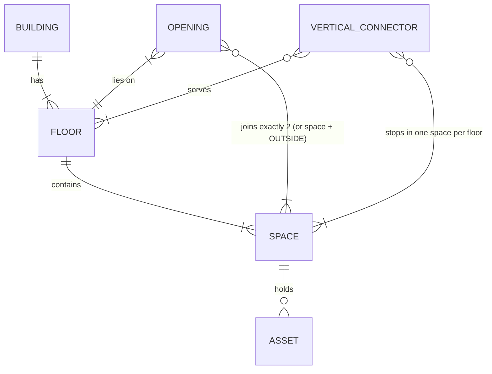

# Synera buildings: what's in the data, and how to represent it

Measured over all **280 buildings** in `synera-kit/data` (train + dev + test): 797 floors, 22,725 spaces,
23,748 openings, 712 vertical connectors, 85,703 assets. Numbers below are counts from the data, not
from the README. Re-run: `uv run python scripts/synera/profile_entities.py synera-kit/data` and
`scripts/synera/profile_graph.py` (connectivity, overlaps, alignment, question inputs).

## 1. The entities



There are only five real entity types plus one pseudo-node. Everything else (rooms, corridors, halls,
stairwells, lifts, balconies) is a **space** with a different `type`.

### Building
`id, name, source, source_ref, license, attribution, split, units` (always metres). `source` matters a
lot, see §3.

### Floor (797)
`id, level, name, elevation_m, height_m`.
- `level` is an integer from **-2 to 9**; 0 always exists. Levels can have gaps (a building with floors
  -2, 0, 1 and no -1).
- `elevation_m` is the absolute floor height, so it's what you need for 3D. `height_m` is 3.0 m typically,
  up to 8 m (factory halls).
- All floors share one XY frame, so they stack, except some Swiss floors that are centred per floor.

### Space (22,725): every walkable area

`id, floor_id, type, room_type, name, ref, polygon, synthetic`. All 8 fields are always present.

| `type` | Count | `room_type`s it carries | Notes |
|---|---|---|---|
| `room` | 16,223 | 23 kinds: bedroom, office, lab, toilet, kitchen, meeting_room, … , `generic_room` (OSM, no tag) | median 15.6 m², up to 2,524 m² |
| `corridor` | 3,369 | `corridor`, and **`stairwell` (933)** | Swiss stairwells are corridors; OSM has a 73,000 m² airport corridor |
| `outdoor` | 1,831 | `balcony` | Swiss + ResPlan only; reached through a door from a room |
| `stair` | 532 | `stairwell` | one space **per floor** per staircase |
| `lift` | 385 | `lift` | one space **per floor** per lift (≈15 m²) |
| `hall` | 385 | lobby, production/warehouse/logistics/assembly/additive zone | factory halls are split into zone tiles |

- `polygon` is a simple outline (3–130 vertices, median 4), not closed, **no holes**. All 22,725 are
  valid; the representative point always lies inside. **82 centroids lie outside** their polygon (L- and
  U-shaped corridors), which matters for `straight_line_3d`, since it's defined on the centroid.
- `ref` is the room number ("0.21"). `name` usually contains it ("Quality lab 0.21"). **Not unique**:
  96 duplicate refs and 104 duplicate names in OSM; procedural repeats "Staircase 1" / "Lift 1" on every
  floor. Always qualify by floor ("Office 0.29 (Ground floor)"), as the questions do.
- A factory hall is a **grid of zone spaces** (H-A1 … H-C5) around an aisle column. Zones are joined by
  12–20 m wide `opening`s along their whole shared edge. So "the hall" is many nodes, not one.

### Opening (23,748): every passage inside a floor

`id, floor_id, space_ids, kind, position, width_m, step_free, synthetic`.

- `space_ids` has **exactly 2 entries, always**. An entrance is `[space, "outside"]` (987 of them).
- `kind`: `door` 20,606 · `opening` (no door leaf: arch, hall boundary) 2,155 · `entrance` 987.
- `position` is one point (the door centre). It's usually within 0.04 m of both outlines, but 128 OSM
  doors sit 1–53 m away.
- `width_m`: 0.41–20 m. Procedural widths are deterministic by room type (office 0.9, lift 1.1,
  lab/seminar/meeting/toilet/stairwell 1.2, storage/server/technical/lobby/canteen/lecture hall 1.6,
  hall-zone openings 12–20, logistics dock entrances 4.0, corridor entrances 1.8 or 5.0). Swiss/ResPlan
  widths come from drawings (0.65–0.96 typical); OSM defaults to 0.9.
- `step_free`: **only 30 of 23,748 are `false`, and all 30 are entrances.** Inside a floor every door is
  step-free.

### Vertical connector (712): stairs and lifts between floors

`id, kind, name, floor_ids, space_ids, step_free, synthetic`.
- `kind`: `stairs` 576 (all `step_free: false`) · `lift` 136 (all `step_free: true`).
- 2–10 stops (412 have 2). Each stop is a (floor, space) pair. Stairs stop in `stair` spaces or, in
  Swiss, in `corridor`/stairwell spaces; OSM lifts mapped as a point stop in a corridor.
- **16 connectors skip a level** (e.g. levels [-1, 1, 2, …]: the ground floor isn't served). The cost is
  per floor of span, so a skip is still a single hop.
- 22 OSM stair spaces have **no doors at all**: you can only enter them by the stair itself.
- 479 of 712 are `synthetic` (recovered by the dataset, mostly Swiss stairwells).

### Asset (85,703): the things you can ask for

`id, name, category, type, space_id, floor_id, position, footprint{width_m, depth_m, rotation_deg}, source`.
- `category`: furniture 60,601 · equipment 13,217 · fixture 11,032 · machine 853.
- 97 `type`s. Industrial ones: 3d_printer, forklift, drill_press, industrial_3d_printer, cnc_mill,
  injection_moulding_machine, cnc_lathe, milling_machine, press_brake, laser_cutter, robot_cell,
  conveyor, … Useful everyday ones: coffee_machine (1,448), fire_extinguisher, toilet, fridge, printer.
- `name` is unique per building ("Desk 2.03-B"). `source`: generated 77,455 (placed by rules) vs
  dataset 8,248.
- Assets **do not block** anything in the route model. A forklift is just an item with a position.

### `"outside"`: one pseudo-node
Every entrance connects to a single `outside` node at zero cost. A route may leave by one entrance and
come back in by another for free (the benchmark avoids cases where this matters).

## 2. "Are all passages the same?" No. What makes a connection usable

| Who is moving | Can't use | Data that decides it |
|---|---|---|
| Walking person | closed elements | `closed` set (runtime) |
| Wheelchair, pram, trolley ("step-free") | all stairs, 30 stepped entrances | `vertical_connector.step_free`, `opening.step_free` |
| Wide load (trolley, pallet, bed, machine) | doors narrower than the load | `opening.width_m ≥ load width`, plus step-free |
| "Can carry it on the stairs" (errands) | nothing extra | explicit in the question |
| Forklift (add-in idea) | narrow doors, stairs, blocked zones | width + step-free + closed hall zones |

Lifts have **no width or capacity** field, so a wide load through a lift is limited only by the lift's
door (1.1 m in procedural). Stairs and lifts also cost differently (§4), so "fastest" ≠ "fewest metres
walked".

Reachability is dramatically different by mode:
- **On foot:** every space in all 280 buildings is reachable from outside.
- **Step-free:** 88 of 109 Swiss buildings have ≥25% of spaces unreachable (stairs only, no lift); 9 of 17
  OSM buildings lose some spaces; procedural and ResPlan are fully reachable.

## 3. The four sources behave differently

| | Procedural (49) | OSM indoor (17) | Swiss Dwellings (109) | ResPlan (105) |
|---|---|---|---|---|
| What | factories, campuses | real TUM/airport/mall buildings | apartment blocks | single-floor homes |
| Floors | 2–7, aligned | 2–8, aligned, level gaps | 1–10, sometimes not aligned | always 1 |
| Shapes | axis-aligned rectangles | rotated, irregular, gaps | rotated, irregular | L-shapes |
| Stairs / lifts | always both | mixed; lifts often synthetic points | stairs always, lift in 36 | none (stair space without connector) |
| Names / refs | clean, unique refs | duplicates, `generic_room` | clean | clean |
| Overlapping spaces | none | **194 overlaps > 1 m²** (rooms on rooms, lifts on corridors) | 1 | 7 |
| Test questions (of 145) | 66 | 32 | 30 | 17 |

Practical rule: build and debug on procedural, then harden on OSM, which is where geometry code breaks
(overlaps, far-away doors, duplicates, level gaps).

## 4. The ground-truth route model (copy it exactly)

From `synera-kit/starter_agent/building_map.py`, used to compute every expected distance:

- **Nodes:** one per space at `Polygon(polygon).representative_point()` (the *anchor*, not the centroid),
  one per opening at its `position`, plus `outside`.
- **Edges:** space ↔ each of its openings, weight = straight-line distance anchor → door. Entrance ↔
  `outside` at 0.
- **Stairs:** 12 m × floors spanned, between consecutive stops. **Lift:** 15 m wait + 6 m × floors.
- **MultiGraph:** a stair and a lift may join the same two spaces; keep both.
- **Step-free:** drop every edge whose element has `step_free: false`.

Consequence to keep in mind: it's a **star per room**. Crossing a room always goes door → anchor → door,
never along the wall, so the distances are "graph metres", not real walking metres. For the benchmark
that's what we must reproduce; for nice animated routes on screen we can draw something smoother.

## 5. Proposed representation

Layered, so geometry, routing, edits and the agent can be built by different people in parallel:

```
L0  Raw plan          building.json, never mutated
L1  Plan model        typed objects + indexes                     (load once per building)
L2  Plan facts        derived geometry, cached                     (pure functions of L1)
L3  Route graph       MultiGraph + edge attributes, filtered by constraints at query time
L4  State overlay     closures, added doors, moved assets: an event log applied on top of L1
L5  Agent tools       find / route / count / edit / react; return compact JSON + ids for the UI
```

**L1 Plan model.** Dataclasses or pydantic for Floor, Space, Opening, Connector, Asset. Indexes:
by id; by floor; space resolution by ref/name with floor qualification (handles duplicates); assets by
type and by space; a per-floor STRtree of polygons for "what's at this point" and neighbour search.

**L2 Plan facts** (precompute per building in well under a second; this is most of the 55 points):

| Fact | Definition (from the README) | Used by |
|---|---|---|
| area | polygon area (shapely) | largest_room, floor_area_total |
| anchor | representative point | all routing |
| centroid 3D | polygon centroid + floor `elevation_m` | straight_line_3d |
| shared wall | ≥ 1 m of outline within 0.35 m of the other outline, same floor; corridors, stairwells and lifts excluded | shared_walls_count |
| stacked above/below | space on next floor up/down covering most of this outline | room_stacked |
| entrance distance | multi-source Dijkstra from `outside` | what_if_door |

**L3 Route graph.** One MultiGraph per building. Every edge carries `via` (element id), `kind`
(door/opening/entrance/stairs/lift), `width_m`, `step_free`, `weight`. Constraints are a **filter at query
time** (`min_width`, `step_free`, `closed`, `no_stairs`), not separate graphs.

| Question kind | Algorithm on L2/L3 |
|---|---|
| locate, count | index lookups (L1) |
| route, step-free, with closure | Dijkstra on the filtered graph |
| tour | sum of Dijkstra legs in the given order |
| errand | Dijkstra from start to every space holding the asset type, take the nearest, then route on to the target room |
| wide_delivery_count, step_free_reachable_count | BFS/Dijkstra reachability from the entrance on the filtered graph, count rooms on the target floor |
| what_if_door | add one edge at the midpoint of the shared wall, re-run multi-source Dijkstra from `outside`, count rooms whose distance drops by more than 1 m |
| room_stacked, shared_walls, straight_line_3d, areas | L2 geometry, no graph |

**L4 State overlay.** Closures, new doors and moved assets as a small event list
(`close(element)`, `add_door(a, b)`, `move_asset(id, space, pos)`) applied over L1. That gives EDIT and
REACT for free, undo, "what changes?" diffs (route before vs after), and the "make things move" add-in.

## 6. Decisions for the team

1. **One building per process, or a multi-building world?** Level 3 wants walkways between buildings,
   and the data has none. Ask Synera how they test it (see questions in `README.md`).
2. **Graph library:** networkx is fine (largest buildings have a few thousand nodes); keep the kit's
   exact cost model either way.
3. **Ids in answers:** the Sunday `answers.json` (per the PDF) wants routes as node ids. Decide whether our
   node ids are space ids only or spaces + openings, once Synera confirms the schema.
4. **What the agent sees:** tools should return names and floors for people, ids for the UI, and never
   raw polygons.
