# Pitch video: storyboard v2 ("Where's the hackathon?")

| | |
|---|---|
| **Runtime** | 48 s (target 45–50 s) |
| **Format** | 1920×1080, 25 fps, 16:9. Phone screen recordings: 1080×2400 portrait |
| **Parts** | A · live action at MUCL, 0:00–0:35 (35 s) · B · 3D animation of MUCL, 0:35–0:48 (13 s) |
| **Location** | Munich Urban Colab, Freddie-Mercury-Straße 5: reception (EG) → main staircase → 3rd floor, Offener Bürobereich Süd |
| **Cast** | GUEST (hoodie, backpack optional) · RECEPTIONIST (behind the counter) · NAVI (app voice, ElevenLabs) |
| **Due** | Final export before Sun 25 Oct, 11:00 |

v1 (fully animated, 60 s, with the facility-manager booking story) is in git at `0a3436c`.

**Logline:** a guest asks reception where the hackathon is. Reception points at a phone. The phone
answers and walks him there, live. Then we show how that building map was made: from floor plans, in minutes.

## Sequence overview

| Seq | Time | Dur | Content |
|---|---|---|---|
| A1 | 0:00–0:11.5 | 11.5 s | Arrival and the question (shots 1–5) |
| A2 | 0:11.5–0:18 | 6.5 s | Navi answers: full-screen app (shots 6–7) |
| A3 | 0:18–0:35 | 17 s | Live guidance: walk with the app overlay (shots 8–12) |
| B | 0:35–0:48 | 13 s | The building model assembles; claim; end card (shots 13–16) |

## Legend

**Shot sizes:** WS wide · MS medium · MCU medium close-up · CU close-up · INS insert · OTS over the shoulder.
**SFX** sound effect · **VO** voice off-screen · **SYNC** on-camera sound · **OVL** overlay graphic ·
**GFX** full-frame graphic. Timecodes are in the edit; "src" is the in-point in the raw clip.

---

## A · Live action

### Shot 1: Walk in · 0:00–0:03 (3.0 s)
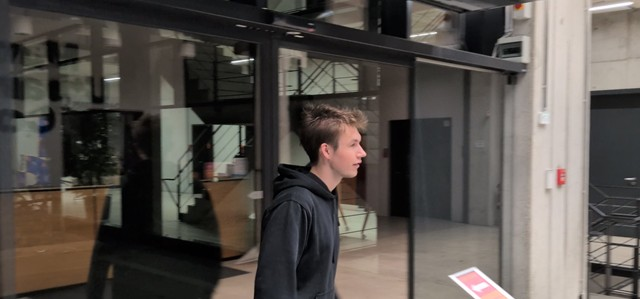

| | |
|---|---|
| **Frame** | WS, static, eye level, from the foyer side of the glass entrance |
| **Action** | GUEST enters through the glass doors and walks right to left toward reception |
| **Audio** | Music bed fades in (light, curious). SFX automatic door, foyer room tone |
| **On screen** | Lower-left title, 0:00.5–0:02.5: *Munich Urban Colab · Saturday, 9:58* |
| **Source** | `PXL_20261025_000341482`, src ≈ 0:00 |
| **Cut** | Hard cut on movement |

### Shot 2: The question · 0:03–0:06 (3.0 s)
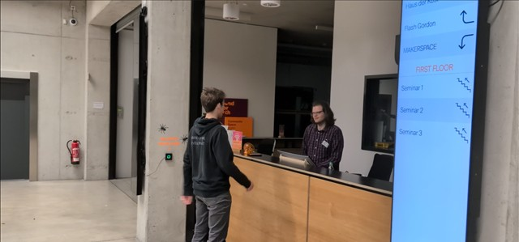

| | |
|---|---|
| **Frame** | WS/MS, static, side angle on the counter; the digital wayfinding sign is in frame on the right (it matters: the static sign can't answer him) |
| **Action** | GUEST stops at the counter and asks |
| **Audio** | SYNC GUEST: **"Hi, where's the hackathon?"** |
| **Source** | `PXL_20261025_000341482`, src ≈ 0:04 |
| **Cut** | Hard cut |

### Shot 3: Reception points · 0:06–0:08 (2.0 s)
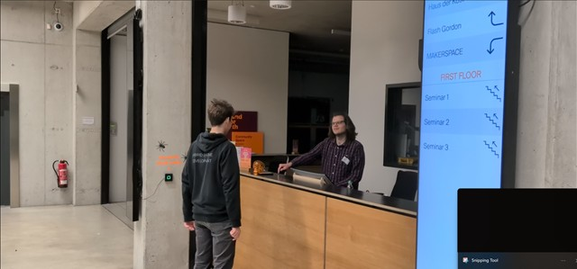

| | |
|---|---|
| **Frame** | Same set-up as shot 2 (or a tighter MS on the RECEPTIONIST) |
| **Action** | RECEPTIONIST barely looks up and taps/points at the phone lying on the counter. Comic beat, keep it dry |
| **Audio** | No dialogue. Music holds one beat (a small rest) |
| **Source** | `PXL_20261025_000341482`, src ≈ 0:06 |
| **Cut** | Hard cut on the pointing gesture |

### Shot 4: Look down · 0:08–0:09.5 (1.5 s)
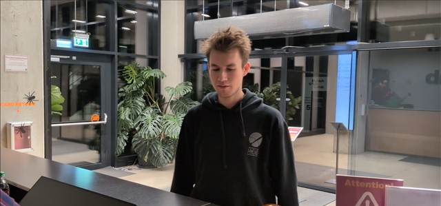

| | |
|---|---|
| **Frame** | MCU, front, from behind the counter (reverse angle) |
| **Action** | GUEST looks down at the phone, a bit puzzled |
| **Audio** | Room tone |
| **Source** | `PXL_20261025_000413439`, src ≈ 0:03 |
| **Cut** | Hard cut |

### Shot 5: Pan down to the phone · 0:09.5–0:11.5 (2.0 s)
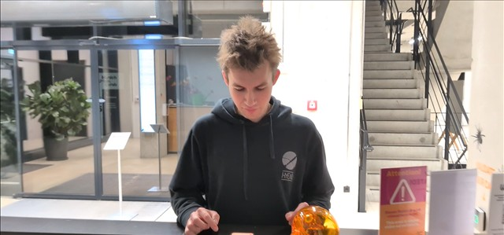
*Reference for framing only: in the take he taps the phone. Nobody touches it in the final shot.*

| | |
|---|---|
| **Frame** | MS front, counter-level, starting on the GUEST's face. The camera tilts down to the phone lying on the counter and ends on it |
| **Action** | Nobody touches the phone. It has already heard the question he asked reception: the screen shows a big microphone symbol, slowly pulsing |
| **Audio** | Room tone. Music holds, a soft "listening" hum under the pulse |
| **Source** | Re-shoot (tilt down; phone already in listening state). Framing reference: `PXL_20261025_000538455`, src ≈ 0:11 |
| **Cut** | Push-in / zoom into the phone screen (0.3 s), matching the mic symbol's position |

### Shot 6: Navi has listened · 0:11.5–0:13 (1.5 s)
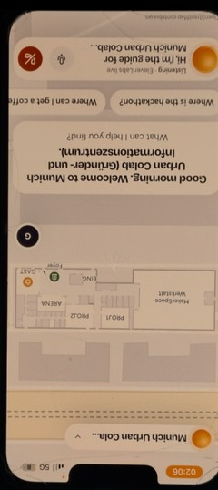

| | |
|---|---|
| **Frame** | GFX: phone screen recording full screen, upright, on a dark blurred background of shot 5. Do not film the phone; use the screen recording |
| **Action** | Big mic symbol keeps blinking slowly; the question he asked reception shows as transcription: *"Hi, where's the hackathon?"*. About 1 s later the instruction panel slides up |
| **Audio** | Soft UI chime as the panel appears |
| **Source** | New screen recording (re-record cleanly; the existing `PXL_20261025_000642236` is filmed sideways and is reference only) |
| **Cut** | Straight on, no cut, into shot 7 (same recording) |

### Shot 7: Navi answers · 0:13–0:18 (5.0 s)
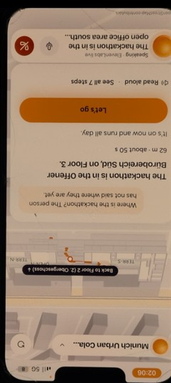

| | |
|---|---|
| **Frame** | GFX: same full-screen recording. Slow 5% push-in on the answer card |
| **Action** | The instruction panel is up: *"The hackathon is in the Offener Bürobereich Süd, on Floor 3. 62 m · about 50 s."* Route draws on the mini map. GUEST's thumb taps **Let's go** at 0:17 |
| **Audio** | VO NAVI (the app's real voice): **"The hackathon is in the open office area south, on the third floor. Follow me."** Music lifts on "Let's go" |
| **Source** | Same screen recording as shot 6 |
| **Cut** | **Key transition:** the full-screen phone shrinks and slides to the right side and becomes the overlay (OVL) over shot 8. 0.5 s, ease-in-out |

### Overlay spec (shots 8–11)

The phone screen recording sits **on top of** the full 16:9 footage. The footage is not cropped or
reframed.

- **Position:** right side, vertically centred, 64 px from the right edge.
- **Size:** 700 px high (about 65% of the frame), so about 315 px wide.
- **Look:** 36 px rounded corners, thin dark phone bezel (8 px), soft drop shadow (black 40%, 24 px blur).
- **Content:** the live navigation screen, recorded at the same moment as the walk, so the step on the
  screen matches where the GUEST is. The app's voice is the dialogue track.
- **Framing for the re-shoot:** keep the GUEST in the left two-thirds of the frame so the overlay never covers him.

### Shot 8: Pick up and go · 0:18–0:21 (3.0 s)
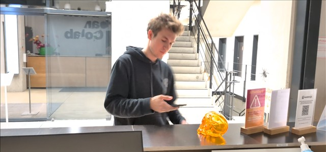

| | |
|---|---|
| **Frame** | MS, static, from behind reception, angled toward the stairs |
| **Action** | GUEST picks the phone up and walks off toward the main staircase, looking at the screen |
| **OVL** | Overlay lands here (from the shot 7 transition). Screen: navigation mode, step 1 |
| **Audio** | Music continues. Footsteps |
| **Source** | Re-shoot with live screen recording (reference: `PXL_20261025_000750022`, src ≈ 0:00) |
| **Cut** | Hard cut |

### Shot 9: Main staircase · 0:21–0:26 (5.0 s)
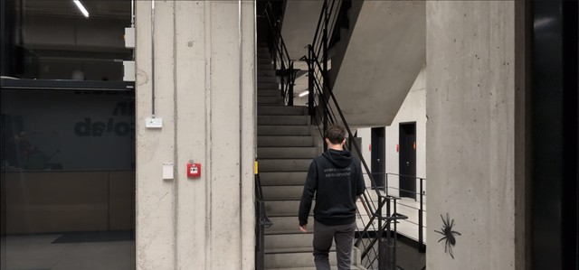

| | |
|---|---|
| **Frame** | WS from behind, static at the foot of the staircase |
| **Action** | GUEST climbs the main staircase |
| **OVL** | Live: route step "Go up the main staircase", blue dot moving |
| **Audio** | VO NAVI (live from the app): **"Go up the main staircase to the third floor."** |
| **Source** | Re-shoot with live screen recording (reference: `PXL_20261025_000750022`, src ≈ 0:04) |
| **Cut** | Hard cut, or an L-cut with NAVI's line running over |

### Shot 10: Top of the stairs (NEW) · 0:26–0:29 (3.0 s)
*No reference frame. Still to be shot.*

| | |
|---|---|
| **Frame** | MS, low angle, from the 3rd-floor landing looking down the last flight. GUEST climbs up into frame toward camera, then turns into the corridor |
| **Action** | GUEST arrives at the top, glances at the phone, turns toward the open office area |
| **OVL** | Live: floor switches to **Floor 3** (the floor chip changes), next step highlights |
| **Audio** | SFX soft chime on the floor change. VO NAVI: the app's next spoken step as recorded (e.g. turn direction into Offener Bürobereich Süd) |
| **Source** | New |
| **Cut** | Hard cut on the turn |

### Shot 11: Arrival · 0:29–0:33 (4.0 s)
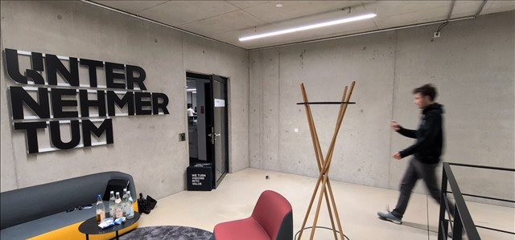

| | |
|---|---|
| **Frame** | WS, static, wide on the UnternehmerTUM wall and the door |
| **Action** | GUEST crosses the room toward the door, eyes on the phone |
| **OVL** | Live: arrival screen. Overlay slides out to the right at 0:32.5 (0.4 s) |
| **Audio** | VO NAVI: **"You have reached your destination."** |
| **Source** | Re-shoot with live screen recording (reference: `PXL_20261025_001129512`, src ≈ 0:02) |
| **Cut** | Hard cut |

### Shot 12: The door · 0:33–0:35 (2.0 s)
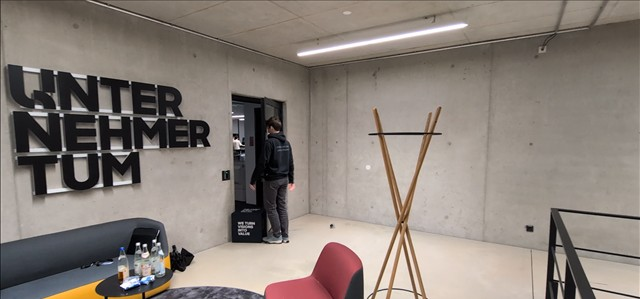

| | |
|---|---|
| **Frame** | Same set-up as shot 11 |
| **Action** | Still looking at his phone, GUEST walks straight into the closed glass door. *Bonk.* (Alternative: he opens it to a room full of hackers. Decide on set; shoot both.) |
| **Audio** | SFX bonk; music stops dead on the impact |
| **Source** | `PXL_20261025_001129512`, src ≈ 0:08, or re-shoot |
| **Cut** | Smash cut to black, 6 frames, then part B |

---

## B · Animation: the building model (0:35–0:48, 13 s)

Rendered from `web/video/` (three.js, `data/MUCL/building.json`). The walls-up and floor-stacking
animation from v1's cold open is the base; it needs a new 13 s timeline. Dark background, same teal/amber
palette as v1. Text: white, large, centred low third, max. 6 words per card.

### Shot 13: The input · 0:35–0:37.5 (2.5 s)

| | |
|---|---|
| **Frame** | GFX top-down: MUCL ground-floor plan as a flat drawing, lines tracing on |
| **On screen** | *"This is a floor plan."* |
| **Audio** | Music re-enters, lower and more serious. Soft pen-scratch SFX |

### Shot 14: The build · 0:37.5–0:43 (5.5 s)

| | |
|---|---|
| **Frame** | Camera tilts from top-down to a 3/4 view and orbits slowly. Walls extrude, rooms fill with colour by type, floors 1–4 stack on top, stairs and elevators connect them |
| **On screen** | 0:38.5 *"Navi turned it into a building it can walk through."* |
| **Audio** | Rising synth swell, a soft click per floor as it lands |

### Shot 15: The claim · 0:43–0:46 (3.0 s)

| | |
|---|---|
| **Frame** | The full 3D model, semi-transparent. The guest's route from part A draws as a glowing line: reception → main staircase → Floor 3 → Offener Bürobereich Süd |
| **On screen** | Large: **"New building map: from days to minutes."** |
| **Audio** | Music peaks |

### Shot 16: End card · 0:46–0:48 (2.0 s)

| | |
|---|---|
| **Frame** | Model fades to a dark silhouette; logo centred |
| **On screen** | **Navi: talk to your building.** · team name · *Synera track · Industrial Agents Hackathon* |
| **Audio** | Final music hit, ring-out to 0:48 |

---

## Sound plan

| Track | Content |
|---|---|
| Dialogue | GUEST sync (shot 2, shown as transcription in shot 6); NAVI = the app's real ElevenLabs voice from the screen recordings (7, 9–11) |
| SFX | Door, footsteps, UI tap, floor chime, bonk, pen-scratch, per-floor clicks |
| Music | One track: light and curious for A, cut dead at the bonk, re-enter for B and build to the end hit. Duck −10 dB under every line |
| Room tone | Foyer and stairwell, under all of A |

Subtitles: burn in all spoken lines (the room at the pitch is loud).

## Shooting list (still to do)

| # | What | Notes |
|---|---|---|
| 1 | Screen recording: shots 6–7 | Phone upright, clean status bar. Ask "Hi, where's the hackathon?" toward the counter, not into the phone; record the big mic pulsing, the panel ~1 s later, then tap "Let's go" |
| 1b | Shot 5 again: tilt down to the phone | Phone already listening (big mic pulsing); nobody touches it |
| 2 | Shots 8–11 again, with live screen recording | Pixel screen recorder with device audio on (captures NAVI's voice). Guest taps the screen visibly once at the start: sync mark |
| 3 | Shot 10 (new): top of the stairs | Camera on the 3rd-floor landing |
| 4 | Shot 12: both endings | Door bump and door open |
| 5 | Part B render | New 13 s timeline in `web/video/scene.js` |

## Before the claim goes on screen

- "From days to minutes" must be true for what we show: time a real run of the floor-plan build
  (`src/app/building/build.py`, Vadim) and keep that number for the Q&A. If MUCL's model was assembled
  partly by hand, say "minutes" only for the automatic part, or show the build on a kit plan instead.
- Room, floor and distance in shots 7–11 come from the app's real output (*Offener Bürobereich Süd,
  Floor 3, 62 m, about 50 s*). If the route changes, re-record; never patch the screen in the edit.
